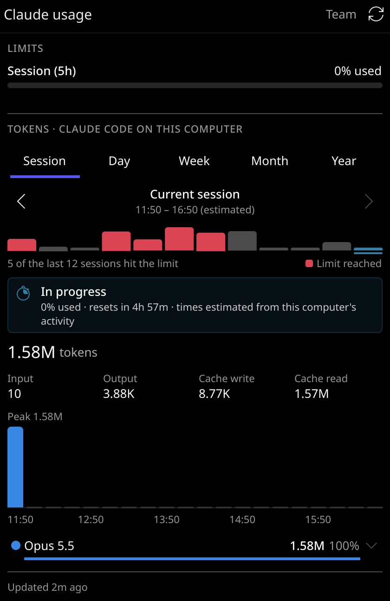
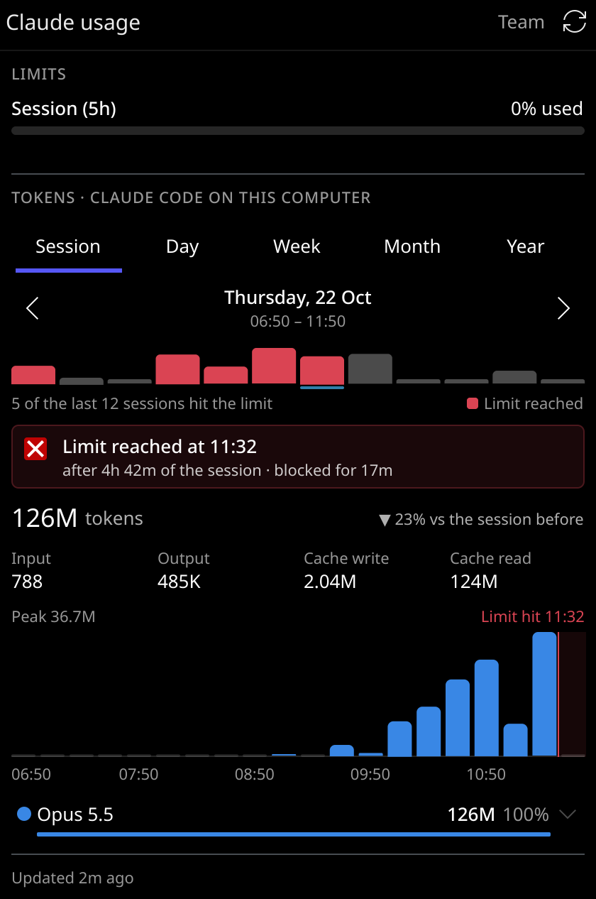

# Claude Usage — KDE Plasma 6 widget

A panel widget that shows how much of your Claude subscription limits you have
used, when they reset, and where your tokens went — per model, per session,
day, week, month and year.

> **Unofficial.** Not affiliated with or endorsed by Anthropic. The limits come
> from an undocumented endpoint that Claude Code itself uses, which can change
> without notice.

<p align="center">
  
  &nbsp;
  
</p>
<p align="center"><sub>The Session tab: the session in progress, and a past session that hit its limit.</sub></p>

## Features

**In the panel**

- A ring gauge, the percentage used and the time until the limit resets, e.g.
  `◔ 37% · 1h 2m`. Each part can be switched on or off, and the reset time can
  be shown as time left (`1h 2m`), clock time (`11:50`) or both.
- Turns amber and red as the limit fills up (thresholds are configurable).
- Left click opens the popup, middle click refreshes.

**In the popup**

- **Limits** — every limit on your plan (5-hour session, weekly, weekly per
  model) with a bar, the percentage used and when it resets. Under the 5-hour
  session bar: the tokens Claude Code on this computer has used in it so far,
  and their cost at API prices.
- **Tokens** — tokens per model for a **session, day, week, month or year**,
  with ‹ › to page back through the history:
  - the total, compared with the same point of the previous period;
  - what the tokens would cost at Claude API prices (≈ $), in total, per model,
    per bar and per session;
  - the split into input, output, cache write and cache read;
  - a stacked bar chart per hour / day / month (hover a bar for its numbers);
  - one row per model (hover to highlight it in the chart, click for details).
- **Session history** — on the Session tab, page through past 5-hour sessions:
  - a strip of the last 12 sessions, red where the limit was hit, click to jump;
  - whether the session **hit its limit**: at what time, how far into the
    session, and how long you were blocked — or else its peak percentage;
  - the blocked stretch shaded in the chart.

The popup sizes itself to the tab you are on and remembers the tab you used last.

## Requirements

- KDE Plasma 6
- Python 3 (standard library only; tested with 3.12)
- [Claude Code](https://claude.com/claude-code) signed in with a Claude
  subscription (such as Pro, Max or Team) on the same computer — the widget
  reuses its login and reads its transcripts.

## Install

```sh
git clone https://github.com/43v3r-y0ung/claude-usage-kdewidget.git
cd claude-usage-kdewidget
kpackagetool6 -t Plasma/Applet -i package
```

Then right-click the panel → **Add or Manage Widgets…** → **Claude Usage**.

Update after pulling changes, or remove:

```sh
kpackagetool6 -t Plasma/Applet -u package
kpackagetool6 -t Plasma/Applet -r io.github.43v3r-y0ung.claudeusage
```

Plasma keeps the old version loaded until it restarts:
`systemctl --user restart plasma-plasmashell`.

## Settings

Right-click the widget → **Configure Claude Usage…**

| Setting | Default |
|---|---|
| Limit shown in panel: session, weekly, or whichever is most used | Session |
| Panel shows: chart, percentage used, reset time (time left / clock / both) | all, time left |
| Refresh every | 5 minutes |
| Also update live while Claude Code works | off |
| Warning / critical colour at | 75% / 90% |
| Claude config directory (if you use `CLAUDE_CONFIG_DIR`) | `~/.claude` |
| Renew an expired login token | off |

## How it works

Two small Python helpers in `package/contents/code/` do the work; the QML only
draws what they print.

### Limits — `fetch_usage.py`

Reads the OAuth login Claude Code keeps in `~/.claude/.credentials.json` and
asks `https://api.anthropic.com/api/oauth/usage`, the endpoint behind Claude
Code's `/usage` command. The token never leaves the script; the widget only
receives percentages and reset times.

Answers are cached in `~/.cache/claude-usage-widget/usage.json`, so several
widget instances share one request, and a rate-limited request backs off for at
least 5 minutes.

The token Claude Code stores expires after a few hours. By default the widget
does **not** renew it: when Claude Code has not been used for a while it keeps
showing the last data, greyed out, until Claude Code renews the token. With
"Renew an expired login token" on, the widget renews it itself and writes the
rotated token back to Claude Code's credentials file.

### Token history — `token_stats.py`

Claude Code writes every response, with its model and token counts, to its
transcripts in `~/.claude/projects/**/*.jsonl`, and deletes transcripts after
30 days (`cleanupPeriodDays`). The helper copies the counts into
`~/.local/share/claude-usage-widget/history.sqlite`, reading each transcript
only from where it stopped last time, so the history outlives the transcripts:
it reaches back to the first time the widget ran, plus the 30 days that were
still there then.

The cost is worked out the way Claude Code's `/cost` does it: each response's
tokens at the [Claude API list prices](https://platform.claude.com/docs/en/about-claude/pricing)
of its model, with 5-minute and 1-hour cache writes, fast mode, US-only
inference and web searches priced as such. It is an estimate of what the usage
would cost on the API, not what a subscription charges, and it runs a few
percent below `/cost`, because some background requests Claude Code makes are
not written to its transcripts. Models without a known price are left out of
the cost.

### Live updates — `watch_activity.py`

Off by default; then the widget only refreshes on its interval. With "Also
update live while Claude Code works" on, the helper waits (with inotify, so
without polling) until Claude Code writes a transcript — once per step of a
response: thinking, a tool call, the answer — or until one of its sessions
turns busy or idle, then answers and is started again:

- the token numbers in the open popup update after every step;
- when a response ends, the limits are fetched again, at most once a minute,
  since the usage endpoint answers 429 when asked too often;
- the tooltip says how many sessions Claude Code is working in.

Busy and idle come from `~/.claude/sessions/<pid>.json`, which Claude Code keeps
for each running instance but does not document; if it changes, the token
numbers still update live and the limits on the interval.

### Sessions

The 5-hour sessions are dated two ways:

- **Known** — when a limit is hit, Claude Code logs the rejection with the exact
  reset time; and at every refresh the widget stores what the usage API reports,
  which also gives each session's peak percentage.
- **Estimated** — otherwise, the way the limit behaves: a session opens with the
  first request after the previous one closed, rounded down to 10 minutes.

Requests made elsewhere (claude.ai, the desktop app, another computer) count
toward the same limit but leave nothing on this computer, so sessions they open
cannot be seen; estimated sessions are labelled as such.

### Privacy

Everything stays on your computer. The database holds token counts, model
names, timestamps, session ids and limit snapshots — never message text. The
token counts cover Claude Code on this computer only.

## Command line

Both helpers print JSON and can be run on their own:

```sh
python3 -I package/contents/code/fetch_usage.py --force
python3 -I package/contents/code/token_stats.py query --period week --offset 1
python3 -I package/contents/code/token_stats.py query --period session --offset 3
python3 -I package/contents/code/watch_activity.py --timeout 60
```

## Troubleshooting

- **"No Claude Code login"** — run `claude` and sign in with `/login`.
- **"Token expired; open Claude Code to renew it"** — use Claude Code once, or
  enable "Renew an expired login token".
- **"Rate limited"** — the usage endpoint was asked too often; the widget waits
  and tries again by itself.
- **Changes do not show up after an update** — restart Plasma:
  `systemctl --user restart plasma-plasmashell`.

## License

[GPL-2.0-or-later](LICENSE)
